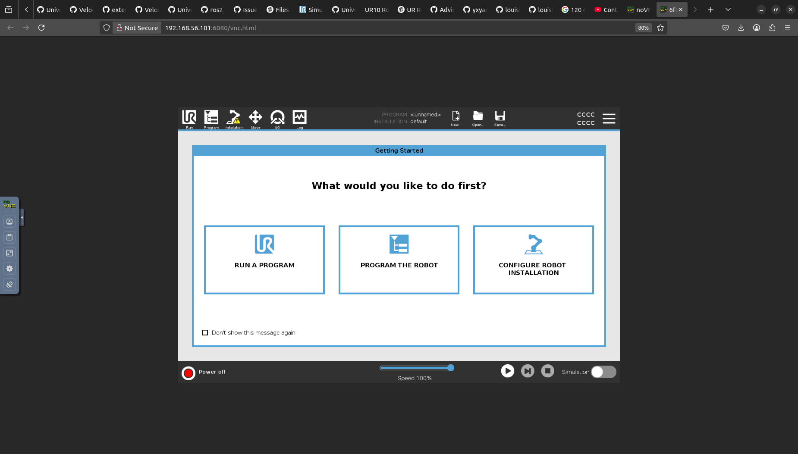
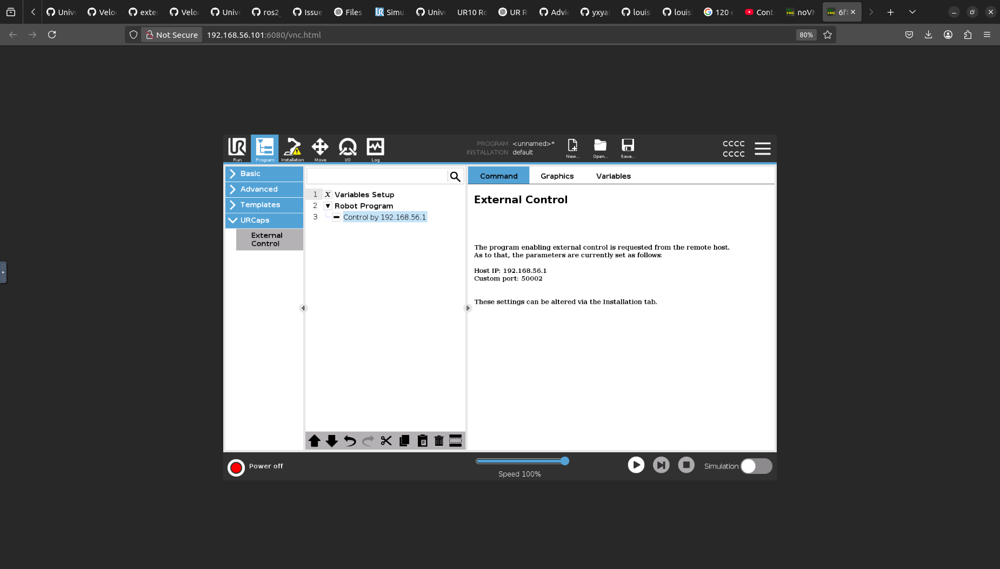
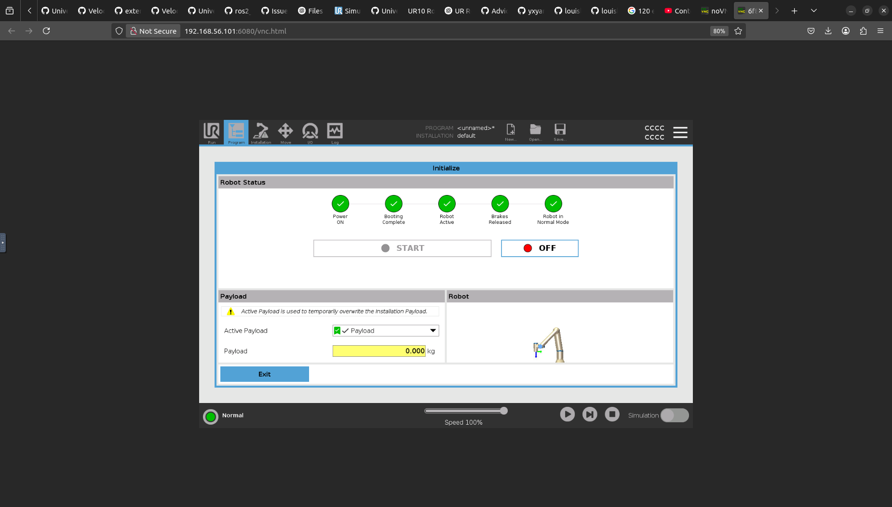
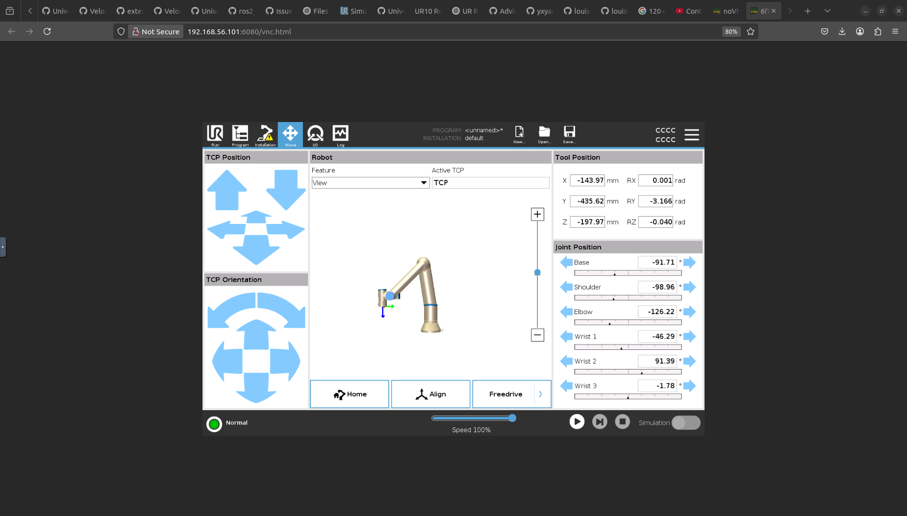
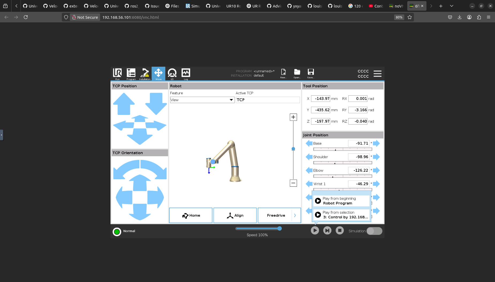

# UR10 Reach Task from Isaac Lab Sim2Real Transfer 

This repository uses a UR10 Reach task trained policy using Isaac Lab to do sim-to-real transfer. It has been tested with ROS2 Humble on Ubuntu 22.04.

## Table of Contents

- [Overview](#overview)
- [Prerequisites](#prerequisites)
- [Installation](#installation)
- [Usage](#usage)
  - [Sim2Sim Setup](#sim2sim-setup)
  - [Sim2Real Setup](#sim2real-setup)
- [Acknowledgments](#acknowledgments)
- [License](#license)

## Overview

This repository provides scripts to test a pretrained UR10 policy in simulation using URSim (sim2sim) and then transfer it to a real robot (sim2real). The simulation is based on the `ur_robot_driver` package. A pretrained policy is available in the `sample` directory. Note that you need to adjust the policy path in `ur.py`.

## Prerequisites

- **Operating System:** Ubuntu 22.04
- **ROS 2:** Humble Hawksbill  
  [Installation guide](https://docs.ros.org/en/humble/Installation/Ubuntu-Install-Debians.html)
- **UR Robot Driver:** [ur_robot_driver](https://github.com/UniversalRobots/Universal_Robots_ROS2_Driver)
- **Python:** Python 3

## Installation

1. **Install ROS 2 Humble:**  
   Follow the [ROS 2 installation guide](https://docs.ros.org/en/humble/Installation/Ubuntu-Install-Debians.html).

2. **Install the UR Robot Driver Package:**  
   ```bash
   sudo apt update
   sudo apt install ros-humble-ur-robot-driver
   ```

3. **Clone the Repository:**
   ```bash
   git clone https://github.com/louislelay/isaaclab_ur_reach_sim2real.git
   ```

## Usage

### Sim2Sim Setup

Follow these steps to run the simulation:

1. **Launch URSim:**

   Open a terminal and run:
   ```bash
   ros2 run ur_robot_driver start_ursim.sh -m ur10e
   ```
   This will launch URSim at http://192.168.56.101:6080/vnc.html. Click **Connect** and you should see an interface similar to:

   

2. **Activate External Control in URCaps:**

   In the **Programs** tab, below **URCaps**, click on **External Control**. Below **Robot Progam** you should see appear  : **Control by 192.168.56.1**

   

3. **Start the UR Robot**

   Click on the red button in the bottom left. Click on **On**, then **Start** until you obtain the following interface:
     
   

4. **Exit and Proceed:**

   - Press **Exit**.
   - Switch to the **Move** tab in the interface:
     
     

5. **Connect the interface to the computer:**

   - Press the play button in the bottom.
   - Select the **Control by 192.168...** option in the interface:
     
     

6. **Launch Robot Control:**

   In another terminal, run:
   ```bash
   ros2 launch ur_robot_driver ur_control.launch.py ur_type:=ur10e robot_ip:=192.168.56.101
   ```

7. **Run the Task Script:**

   Navigate to the Python directory within the repository:
   ```bash
   cd <path_to_repository>/isaaclab_ur_reach_sim2real/python
   ```
   **Note:** Ensure that the policy path in `ur.py` is updated to point to your pretrained policy (one is available in the `sample` directory if needed).

   Finally, run:
   ```bash
   python3 run_task.py
   ```
   The robot’s end effector should move to the target pose specified in the script.

8. **Demonstration Video:**

   Click on it to go to the youtube video and see the result.

   [](https://www.youtube.com/watch?v=B4jCdmKzhKA)

### Sim2Real Setup

This section is a work in progress (WIP).

After stable insertion succeeds, deployment holds for 30 control steps, then
withdraws 10 cm along the reverse of the latched mouth entry axis while maintaining
the end-effector orientation. The complete withdrawal is planned and published
once as one continuous trajectory, with smooth start/stop and continuous velocities
through its internal path samples. There is no feedback wait or pause between
samples. Its nominal average speed is 5 cm/s (2 seconds for 10 cm), subject to joint
velocity limits and UR speed scaling. Automatic joint reset starts only after
feedback confirms the withdrawal target (2 mm position tolerance) and a stable
stop outside the mouth. The same deployment node immediately publishes the reset
trajectory using its existing connection, without starting another process or
rendering plots first. Reset uses a nominal joint speed of at most 0.25 rad/s and
a minimum duration of 4 seconds. Plots are saved after reset completes or times out,
so joint feedback continues to be recorded throughout reset.
Withdrawal timeout, invalid feedback, or path/workspace
violations stop the episode without automatic reset. `--withdraw-distance` changes
the withdrawal distance in meters (default `0.10`, minimum `0.08`). In `--dry-run`,
the withdrawal goal is logged without publishing withdrawal or reset motion.

Running `python3 deploy/run_task.py` automatically records the six measured joint
angles to `logs/joint_angle_records/joint_angles_<timestamp>_<mode>.csv`. Columns
contain elapsed time in seconds and each joint angle in radians. Feedback is
sampled at most at `--control-hz` (30 Hz by default), including pauses and automatic
reset motion while the node is running. At episode end (after automatic reset, if
enabled) and on Ctrl+C, a matching
PNG overlays all six curves on one axis with a legend; the vertical axis spans
`-2π` to `2π` radians.
The CSV retains the original angles without clipping or wrapping. This also works
with `--dry-run`.

### Tool Mass and Center-of-Mass Calibration

Use `deploy/measure_tool_com.py` to identify the combined gripper-and-spoon payload from static multi-pose force/torque measurements. The procedure, safety constraints, output fields, and simulation update method are documented in [TOOL_COM_CALIBRATION.md](TOOL_COM_CALIBRATION.md).

## Acknowledgments

- **[Johnson Sun](https://github.com/j3soon)**: Many thanks for his valuable advice and time.
- **UR10Reacher Sim2Real for Isaac Gym:** [UR10Reacher repository](https://github.com/j3soon/OmniIsaacGymEnvs-UR10Reacher)
- **Isaac Lab:** [Isaac Lab repository](https://github.com/isaac-sim/IsaacLab)
- **UR Robot Driver:** [UR Robot Driver repository](https://github.com/UniversalRobots/Universal_Robots_ROS2_Driver)
- **ROS 2 Community:** [ROS 2 project](https://docs.ros.org/en/humble/index.html)

## License

This project is licensed under the [MIT License](LICENSE).
